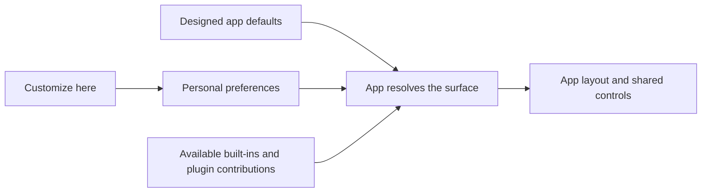

# Your workspace, with excellent defaults

Design proposal, 22 September 2026. Research and recommendations, not shipped behavior.

> T3 should feel complete before you change a setting. When you want it to work differently, the controls you use every day should be easy to make your own. You choose what matters; T3 takes responsibility for making it look and work well.

Customization belongs in the default app. Plugins can add capabilities and content to the same surfaces, but installing a plugin should never be a prerequisite for arranging the composer, choosing thread details, or simplifying the workspace panel.

The useful freedom is choosing **content, emphasis and density**. T3 should continue to design the geometry: spacing, alignment, type hierarchy, colors, touch targets and behavior at different widths. A toolbar with your five favorite controls should look as intentional as the toolbar we ship.

## The surfaces worth personalizing

Priority reflects frequency of use and the value of different preferences. It is a proposed order, not a commitment to implement every setting. Existing capabilities are detailed in the [source inventory](customization-surface-inventory-2026-09-22.md).

| Surface                      | Choices worth giving people                                                                         | How it stays coherent                                                    | Priority                       |
| ---------------------------- | --------------------------------------------------------------------------------------------------- | ------------------------------------------------------------------------ | ------------------------------ |
| Floating workspace panel     | Sections, their order, individual items, Always / When relevant / Hidden, preferred collapsed state | One column of app-designed sections; consistent headings and spacing     | First, already being worked on |
| Composer                     | Favorite secondary controls, their order, what goes into More, context sources, density             | Stable input and send area; a designed control strip and overflow menu   | First                          |
| Thread list rows             | Density, visible metadata, metadata order, quick actions                                            | A few row templates; title and state remain readable; consistent heights | First                          |
| Thread list organization     | Grouping, sorting, preview counts, visible shelves and filters                                      | Existing list and shelf patterns; hidden sections stay reachable         | Next                           |
| Thread header                | Frequently used actions and metadata, icon or labeled presentation where supported                  | Thread identity and state remain stable; secondary actions go into More  | Next                           |
| Panel tabs and bottom dock   | Favorite tools, tab order, preferred location, sizes, reopen behavior                               | Existing docking positions and minimum sizes; one focus/layout owner     | Next                           |
| Conversation timeline        | Tool detail, reasoning visibility where supported, timestamps, message width, code wrapping         | Curated reading modes; errors and pending decisions remain discoverable  | Next                           |
| File browser and editor      | Hidden files, sorting, explorer detail, editor typography and wrapping, preferred open action       | Normal tree/editor patterns; global typography tokens                    | Later                          |
| Diff and review              | Unified or split view, whitespace, wrapping, context detail, review toolbar favorites               | Review controls and unresolved changes remain reachable                  | Later                          |
| Terminal                     | Font, size, contrast, favorite commands, default split direction, toolbar controls                  | Existing terminal behavior and clear focus ownership                     | Later                          |
| Command palette and keyboard | Favorite commands, shortcuts, plugin command visibility                                             | One searchable command catalogue and conflict handling                   | Alongside added actions        |
| Attention and appearance     | Which events notify, sounds, motion, theme, text sizes                                              | Reuse existing appearance/settings systems; preserve legibility          | Gradually                      |

The workspace panel is specifically the floating **ThreadDetailsPanel** used in V2. It is distinct from the right-hand Files/Browser/Diff tabs. Its current source assembles Workspace, Version Control, Automations and thread relationships in a fixed order, with some conditional visibility already present. [L2]

## One familiar editing experience

Use the same entry and recovery pattern everywhere, with controls suited to each surface. A section list, a toolbar and a thread row do not need the same layout editor.

1. **Customize here.** A pencil appears on hover and keyboard focus. The surface's menu also contains Customize, giving touch and keyboard users a persistent route. Settings → Appearance provides an overview and recovery path, and the command palette can find each editor.
2. **Start from Recommended.** Open a small editor next to the actual surface. Offer a few meaningful presets only where they help. Do not ask new users to choose a layout during onboarding.
3. **Adjust what is present.** Reorder, pin, move to More or hide. Expand an item only when it has useful options. Give each conditional control a plain explanation, such as “Shows when this workspace uses Git.”
4. **Preview the result.** Changes affect a temporary presentation of the current surface. The preview uses the real renderer. Offer representative states when the current thread lacks them, such as “With subagents” or “Working.”
5. **Done, Cancel, Reset.** Done saves one preference change. Cancel restores the previous presentation. Reset affects this surface and offers undo. An empty customized surface still has a route back through Settings and the command palette.

Editing should never run a command, submit a prompt, switch branches, stop a terminal or discard a draft. Previewing a different arrangement changes presentation only. Preserve focus and scroll position while trying it.

Three related ideas need different labels:

| Surface kind                              | Appropriate choices                                     |
| ----------------------------------------- | ------------------------------------------------------- |
| Workspace section or optional information | Always, When relevant, Hidden                           |
| Toolbar action                            | Pinned, In More, Hidden from this toolbar               |
| Thread metadata                           | Select fields and priority within a chosen row template |

“Hidden” means absent from that place, not disabled throughout the product. “Always” does not conjure an unsupported provider feature or grant access. An always-visible Git section in a non-Git project can show a small explanatory state. An unsupported model control stays unavailable with an explanation in the editor.

## Three concrete designs

### Floating workspace panel

Build on the other thread's proposal: a pencil, a section palette, per-item visibility and relevance. Preserve its work rather than creating a second implementation. [T1]

The editor has two areas: **On your panel**, an ordered list, and **Available sections**, a searchable palette. Each section row has its visibility setting and a disclosure for its items. Dragging is optional; Move up/down works with keyboard and touch.

```text
Customize workspace                         Done

On your panel
  Workspace             Always              >
  Version control       When relevant       >
  Subagents             When relevant       >

Available sections
  Automations                                +

Preview:  Current thread  |  With subagents
Reset to recommended                      Cancel
```

Opening Version control exposes real items such as branch, changes and available Git actions. The user can emphasize what they use without changing the section's typography or inventing a layout. Match the current product's final section names during implementation; the inspected V2 branch calls relationships “Lineage.”

Make relevance predictable: Git uses actual repository availability; subagents uses the thread relationship state; automations uses bound tasks. Use the state the app already knows. Do not create a separate polling loop to decide whether to show a section. Treat loading, unavailable and empty as different states.

An item becoming relevant must not move a button under the pointer or take keyboard focus. Preserve section order, retain an active interaction until it finishes, and update between interactions. Optional section hiding must not become the only way to discover a pending approval, failure or question.

### Composer

The composer deserves the same ownership, but it needs stronger layout constraints because people develop muscle memory around sending and stopping.

Keep the prompt editor, attached context, primary action and a compact indication of the current target/model as stable regions. Personalize the secondary control strip: pin the controls you use, choose their order, and move less-used controls into More. Model configuration and access mode keep their existing meanings; rearranging a control never changes its value.

```text
Attached context:  README.md   Issue ABC-42
┌──────────────────────────────────────────────────┐
│ Describe the next change...                       │
│                                                  │
│ + Context   Model   Effort   Plan   More      Send │
└──────────────────────────────────────────────────┘

Customize composer
  Pinned:          Model, Effort, Plan
  In More:         Access, Stash
  Available:       Voice, other supported controls
  Density:         Comfortable / Compact
```

These labels illustrate the arrangement, not a promise that every provider supplies every control. The renderer uses capability information for Codex, Claude, Cursor, Grok and OpenCode. Keep a user's preference when switching to a provider that lacks a control, then restore it when available again.

Allow more controls to be pinned than a narrow window can display. Respect the saved priority, move the lowest-priority secondary controls into More, and restore them as width returns. Prefer overflow to shrinking everything or wrapping controls into a disorderly second row. Send/Stop remains stable and usable. When a phone offers both steering and stopping, preserve both actions.

A context plugin appears among context sources and can be pinned through this editor. It should use the same app-rendered button and removable context chip. The plugin produces the context; the app owns how it is selected, inspected, removed and sent. Existing MacBook work already follows much of this separation. [R2]

The current composer has responsive compact controls and special primary actions for approvals, questions and plan follow-ups. Reuse that behavior. Customization must not flatten those states into a static toolbar or take ownership of draft persistence. [L3]

### Thread list rows

Revisit the useful intent of #9967 without coupling it to the reverted collapsed icon rail. Start with **Comfortable** and **Compact** templates, plus detail selection. A third layout should earn its place through actual use.

Keep title and thread state as visual anchors. Let people choose whether the supporting line contains project, branch, model, PR, environment or elapsed time, and in what priority. Show a preview with long titles, a remote environment, a working thread, an unread thread and an error.

Use named slots and automatic overflow. A one-line row should remain a well-proportioned one-line row, even when someone selects five optional fields. Reserve a readable title width; lower-priority metadata moves to the hover/touch detail view. For two-line rows, preserve the same two-line structure across the list instead of varying every row's height.

Quick actions can be chosen and ordered separately. Keep destructive actions in the existing menu/confirmation flow. A future plugin could contribute a concise CI result or issue badge, but should not mount an arbitrary miniature app inside every row.

The historical closure establishes a removed dependency, not a public explanation rejecting customization. A fresh design should therefore be judged on its own. [G1]

## How to keep it looking good

Offer choices that remain inside a designed composition:

- Fixed spacing, type, icon sizing, corner treatment and alignment from the app's design system. Appearance changes reuse theme and typography settings rather than adding colors and fonts to each surface editor.
- Bounded templates for compact areas. A composer control strip, thread row and floating section each have their own rules. Full panels can support richer content.
- A small set of density choices that also respect larger text and touch targets. A “compact” desktop preference must not become tiny phone buttons.
- Predictable information hierarchy. Title, state and primary actions keep their prominence; optional metadata is secondary.
- One icon and label vocabulary. Avoid every installed plugin bringing a new button shape, badge style or attention-grabbing accent into the app's shared controls.
- Stable layouts. Do not reorder controls according to inferred frequency or continually animate something because it is active. Relevance can reveal content without changing saved order.
- Recovery at the point of change. Defaults remain visible, reversible and actively maintained. Personalization should not leave people stuck with a stale copy of the app's old design.

Curated presets are useful examples. A marketplace of complete layouts, arbitrary coordinates, per-widget CSS and conditional scripting would introduce much more design and maintenance work than these first surfaces need.

## What the MacBook plugin work actually contains

I inspected it over SSH at `personal-macbook-pro`, in `/Users/saphid/projects/T3 Code/t3-extensions-authoring`. There is substantial implementation, beyond a packaging proposal. These are source findings, not a new runtime or parity certification.

| Area                   | Evidence found                                                                                      | Consequence for this proposal                                                                        |
| ---------------------- | --------------------------------------------------------------------------------------------------- | ---------------------------------------------------------------------------------------------------- |
| Package lifecycle      | SDK authoring/build/check, installed packages, grants, dependencies, update, rollback and disable   | Reuse for additional capabilities; basic customization needs none of this setup                      |
| Views                  | Namespaced surface IDs, client/scope declarations, placement descriptors and saved view records     | Plugin views can join app-owned panel arrangements                                                   |
| Lifecycle              | Hide/show/move/close, cancellation, retained view identity and missing-plugin fallbacks             | Hiding a tool can preserve its session; avoid inventing another lifecycle                            |
| Domain capabilities    | Contracts for files, editing/search, terminal, browser, VCS, orchestration and provider status      | Plugins can supply substantial workflows, not just cosmetic widgets                                  |
| Composer and messages  | Context contributions, captured text, message decorations and related APIs                          | Context sources and bounded message additions fit the native editor model                            |
| First-party migrations | Files, Diff, Terminal, Browser, Version Control and Agents packages                                 | Built-in features can use extension infrastructure internally without exposing plugin setup to users |
| Newer UI branch        | Theme preferences/tokens, notifications, keybindings/commands, panels and client-targeted providers | Useful integration points, but separate branch work must not be presented as fully integrated        |

The strongest existing design decision is explicit: **“The SDK deliberately does not create a competing layout or focus manager.”** The right-panel store remains the owner. That is the direction to preserve. [R2]

There are real limits. The inspected documentation says extension views support web and desktop, with native mobile renderers still separate work. It describes independently installed Files replacement as partial, with other panels still bundled integrations. The descriptor includes `full-page` and `compact-detail`, but that alone does not establish a working floating-panel item or thread-badge integration. The newer UI branch exposes side-panel and bottom-dock operations. [R1, R3, R5]

## Ownership and the plugin seam

**The user customizes the app. A plugin contributes something the app can offer them.**

| App owns                                                                  | Plugin supplies                                        | User decides                                                |
| ------------------------------------------------------------------------- | ------------------------------------------------------ | ----------------------------------------------------------- |
| Defaults, editor, layout, overflow, appearance and preference persistence | A named capability or contribution with a stable ID    | Whether it appears, where allowed, and with what prominence |
| Focus, keyboard arbitration and command entry points                      | Commands and availability                              | Favorites and shortcut overrides                            |
| Context review, draft persistence and submission                          | Selected context content                               | Whether that content enters the prompt                      |
| Readable shared controls                                                  | Labels, icons, state and actions in an accepted format | Which compact contributions they want to see                |

For **compact shared surfaces**, add narrow contribution kinds as they become necessary: workspace section, composer action/context source, thread metadata badge. The host renders these using its own primitives and budgets. Do not infer that the existing generic surface descriptor already provides them.

For **full tool views**, preserve the richer extension view mechanism. A database inspector may need a substantial custom view. Its tab, toolbar integration and placement still belong to the shell. Trusted React code is not a styling sandbox; consistent shared controls require an explicit host-rendered contract, not just a suggestion to plugin authors.

Installing a plugin should make its optional contributions available in the relevant editor, not automatically pin a new row of controls. Chosen items use the same edit flow as built-ins. Disabling a plugin removes active behavior, preserves the saved preference, and shows an unavailable explanation in the editor. Avoid leaving empty holes in a toolbar; an explicitly open missing tool can retain the existing readable fallback.

The newer plugin UI branch can also write theme preferences and open panels. Use those existing authorities deliberately. A package must not silently rewrite the person's arrangement merely because it can contribute a view. Any future arrangement command should pass through the app's same customization interface, with the same validation, undo and conflict behavior. [R5]

## Small implementation model

Keep the first version app-owned and small. Surface-specific preference records plus a few shared editor controls are enough. Generalize where the panel and composer actually share behavior; do not start with an arbitrary UI-description language.

The useful seam is a **personalization module** with a small interface: resolve the effective arrangement, preview a change, save it, reset it. It hides default merging, validation, unavailable items and responsive fallback. The plugin registry supplies available contributions; it does not become a second preference store or renderer for the whole shell.



Store stable item IDs and intentional overrides, not pixel positions or copies of entire defaults. An untouched surface follows improved defaults. An explicitly hidden item stays hidden after an update. New built-ins follow a documented insertion policy; new plugin contributions begin unpinned. Unknown IDs remain recoverable so reconnecting to a remote environment or reinstalling a plugin can restore the preference.

Start with personal **client** preferences using the existing settings persistence. Do not put presentation choices into shared project state or the server's orchestration events. The same environment may be used from a phone and a large desktop; one client's layout should not rearrange the other. Preserve environment-scoped plugin identity when resolving contributions. Account sync, portable presets and per-project overrides can come later if there is a clear use case. [L4]

Treat desktop, narrow web and native mobile as designed variants. They can share preference meanings and a resolver while using different native controls. Until mobile has a renderer for a plugin contribution, keep it unavailable there and preserve the preference. Do not advertise parity merely because the contract is shared.

Only visible surfaces should do presentation work. Thread-row customization must resolve from existing summary state and remain cheap across a long list; plugin badges must not create one network request or timer per row. Reuse the extension host's visibility lifecycle for larger views.

## A sensible delivery sequence

1. Use the floating-panel effort already in progress to prove Customize, relevance, per-item visibility, preview and reset. Keep its scope focused on that surface.
2. Apply the same entry/recovery pattern to composer control pinning and overflow. Share only the proven pieces. This is the best test of whether the idea works beyond a section list.
3. Revisit thread-row templates as a separate proposal, independent of the removed icon rail. Density and chosen metadata can deliver much of #9967's value with fewer layout choices.
4. Connect one actual plugin contribution, such as a context source, through the same composer editor. Add a new compact contribution contract only when a concrete second use needs it.
5. Extend to header actions and panel favorites, then evaluate the lower-priority surfaces through actual use.

Evaluate with ordinary and difficult states: untouched defaults; long titles; large text; keyboard and touch; narrow widths; working, failed and pending-input threads; remote disconnection; missing plugins; switching providers; undo and reset. For each surface, check every existing menu, command and keybinding still reaches the same action.

Success means somebody who never customizes anything gets a carefully designed app, while somebody who does can remove friction in seconds and still end up with a carefully designed app.

## Source record and limits

All observations were read on 22 September 2026. No browsers, servers, plugin installs or remote mutations were used for this investigation. Existing checks described by other work were not rerun. Local and remote branches differ; this is a design synthesis, not a claim that all referenced code is in upstream main.

- **L1. Local source inventory:** [surface inventory](customization-surface-inventory-2026-09-22.md). Canonical checkout observed at `b9cba6dac8516b0323582288cf88371607a65a56`, with pre-existing working changes.
- **L2. V2 workspace panel:** local `.wt/v2-compact-base`, observed HEAD `37671bd3993cec2bf45f856028ff5bef130fc7ea`; `apps/web/src/components/chat/ThreadDetailsPanel.tsx:123`, `ThreadAutomationsPanel.tsx:60`, `ThreadRelationshipsControl.tsx:247`. Read as an example of the V2 implementation, not selected as the delivery base.
- **L3. Composer:** V2 `apps/web/src/components/chat/ChatComposer.tsx:1302`, `:3367`, `:7284`; canonical `apps/web/src/components/chat/CompactComposerControlsMenu.tsx:14` and `ComposerPrimaryActions.tsx:69`.
- **L4. Existing settings:** canonical `packages/contracts/src/settings.ts:134`, `apps/web/src/hooks/useSettings.ts:184`, `:195`, `:352`, and `apps/desktop/src/settings/DesktopClientSettings.ts:149`.
- **T1. Floating-panel requirements:** live T3 thread `4af951d1-24eb-46f2-abb1-8ee281d5843a`, “Customize Floating Workspace Panel,” original user message at 2026-09-22 04:18:40 UTC. Read through `t3_thread_read`. The legacy projection reader did not expose this V2 thread.
- **R1. Remote integration documentation:** host `personal-macbook-pro`, repository `/Users/saphid/projects/T3 Code/t3-extensions-authoring`, observed HEAD `be1af456f861a9300f8a093469d5587782a00f3d`; `docs/user/extensions.md:3`, `:14`, `:24`, `:40`; `packages/extension-sdk/README.md` and `AUTHORING.md`.
- **R2. Host ownership and lifecycle:** same remote checkout, `packages/extension-sdk/HOST.md:13`, `:23`, `:31`. Especially explicit shell layout/focus ownership and captured composer context.
- **R3. Extension descriptors and registry:** same checkout, `packages/extension-sdk/src/contracts.ts:9`, `:23`, `:39`; `apps/web/src/extensions/workspaceRegistry.tsx`. These establish identities and available descriptor shapes, not universal client support.
- **R4. Domain work:** same checkout, `packages/extension-sdk/src/catalogue.ts`, `orchestration.ts`, and `packages/first-party-extensions/{files,diff,terminal,browser,version-control,agents}`. Integration branch `devin/phase1-integration` observed at `600c10f71e8550d5aad204101a27c2453acef2c4`.
- **R5. Newer UI work:** remote branch `devin/t3-ui-contracts` at `45d080ee4ac328664bae068ceaebd1afced4b553`, read with `git show` without checkout. `packages/extension-sdk/src/catalogue.ts:5295`, `:5304`, `:5539`, `:5686`, `:5812`; `src/clientProviders.ts`; `apps/web/src/extensions/extensionCommandRegistry.ts:946`. Contains UI capabilities and user-keybinding precedence. Its authoring thread still described integration/review work in progress.
- **G1. Prior layout work:** [#9967](https://github.com/pingdotgg/t3code/pull/9967), [closure comment](https://github.com/pingdotgg/t3code/pull/9967#issuecomment-5658976243), [revert #11685](https://github.com/pingdotgg/t3code/pull/11685). The revert's deeper rationale was not documented in the public material checked earlier in this conversation.

Remote source can be revisited without changing the checkout: `ssh personal-macbook-pro`, then `git show <recorded-sha>:<path>` from the repository above. Thread discussion provided orientation; source files support the capability claims.
